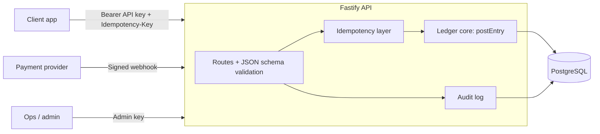

# Kosta

A double-entry ledger and payments API for wallet-based fintech products. It covers wallets, wallet-to-wallet transfers, bank payouts with admin review, and signed deposit webhooks from payment providers, built so money can never be created, lost or spent twice.

**Stack:** Node.js 22, TypeScript (strict), Fastify 5, PostgreSQL 16, OpenAPI 3.1 / Swagger UI, Vitest, Docker, GitHub Actions.

**Live Swagger docs:** https://mighty-odewumi.github.io/kosta/ (OpenAPI 3.1, regenerated from the code on every push). Try it out sends real requests to the public sandbox at https://kosta-api.onrender.com, which also serves its own Swagger UI at [`/docs`](https://kosta-api.onrender.com/docs). The free instance sleeps when idle, so the first request can take around 30 seconds.

---

## Why this exists

Most wallet backends fail in the same few ways. Two requests race and spend the same balance twice. A mobile client retries a timed-out request and the user is charged twice. A payment provider resends a webhook and the wallet is credited twice. A balance column drifts from reality and nobody can say why. Kosta is a reference build that closes each of those holes at the application layer **and** at the database layer, and proves it with tests.

## Guarantees and how they are enforced

| Guarantee | Application layer | Database layer |
|---|---|---|
| Every movement balances (debits = credits) | `postEntry()` rejects legs that do not sum to zero | Deferred constraint trigger rejects any unbalanced journal entry at `COMMIT` |
| No overdrafts, no double spend | Accounts row-locked with `SELECT ... FOR UPDATE` before balance checks | `CHECK (kind = 'system' OR balance >= 0)` on `accounts` |
| No deadlocks between opposite transfers | Locks taken in a fixed order (by account id) | |
| Retries never move money twice | `Idempotency-Key` required on transfers and payouts; responses replayed | `(api_key_id, key)` primary key; response saved in the same transaction as the money movement |
| Webhooks credit exactly once | HMAC-SHA256 signature, 5 minute replay window, constant-time compare | `UNIQUE (provider, event_id)` and `UNIQUE (provider, provider_reference)` |
| History cannot be rewritten | Corrections are new entries | Triggers block `UPDATE` and `DELETE` on `postings` and `journal_entries` |
| No rounding errors | All amounts are integers in minor units (kobo, cents) and validated as integers at the edge | `bigint` columns, no floats anywhere |
| Books can be proven correct | `GET /v1/admin/reconciliation` | Cached balances checked against the sum of postings |
| Every change is attributable | Audit row written in the same transaction as each change | `audit_log` table |

## Architecture



### The money model

Every balance change is a **journal entry** made of two or more **postings** that sum to zero. Three system accounts exist per currency:

- `settlement` mirrors money held at the bank or payment provider. It goes negative when customers deposit, since that money is owed to them.
- `withdrawals_pending` holds funds reserved for payouts awaiting review.
- `fee_revenue` collects platform fees.

| Event | Postings |
|---|---|
| Deposit of 5,000 | settlement **-5,000**, customer **+5,000** |
| Transfer of 1,500 | sender **-1,500**, receiver **+1,500** |
| Payout request of 2,000 (fee 10) | customer **-2,010**, withdrawals_pending **+2,010** |
| Payout approved | withdrawals_pending **-2,010**, settlement **+2,000**, fee_revenue **+10** |
| Payout rejected | withdrawals_pending **-2,010**, customer **+2,010** |

Because funds are moved into `withdrawals_pending` the moment a payout is requested, they cannot be spent again while the payout is in review, and the customer's balance always shows what they can actually use.

## API overview

| Method | Path | Purpose |
|---|---|---|
| `POST` | `/v1/accounts` | Open a single-currency wallet |
| `GET` | `/v1/accounts` | List your wallets |
| `GET` | `/v1/accounts/{id}` | Balance and status |
| `GET` | `/v1/accounts/{id}/transactions` | Statement with running balance, cursor-paginated |
| `POST` | `/v1/transfers` | Wallet-to-wallet transfer (idempotent) |
| `GET` | `/v1/transfers/{id}` | Transfer details |
| `POST` | `/v1/withdrawals` | Request a bank payout, places a hold (idempotent) |
| `GET` | `/v1/withdrawals/{id}` | Payout status |
| `POST` | `/v1/webhooks/deposits` | Signed deposit notification from a provider |
| `GET` | `/v1/admin/withdrawals` | Payout review queue |
| `POST` | `/v1/admin/withdrawals/{id}/approve` | Settle a payout |
| `POST` | `/v1/admin/withdrawals/{id}/reject` | Release the hold |
| `POST` | `/v1/admin/accounts/{id}/freeze` | Compliance hold: blocks debits, allows credits |
| `POST` | `/v1/admin/accounts/{id}/unfreeze` | Lift the hold |
| `GET` | `/v1/admin/audit-log` | Who did what, filterable by target and action |
| `GET` | `/v1/admin/reconciliation` | Prove the books balance |
| `GET` | `/health` | Liveness and database check |
| `POST` | `/sandbox/api-keys` | Sandbox only: self-issue a test API key |
| `POST` | `/sandbox/deposits` | Sandbox only: fund a wallet with test money (same ledger path as webhooks) |

All errors share one shape, so clients branch on a stable `code`:

```json
{ "error": { "code": "insufficient_funds", "message": "The account does not have enough available balance.", "details": { "available": 10000, "required": 10001 } } }
```

## Quick start

**With Docker**

```bash
docker compose up --build
docker compose exec api npx tsx scripts/seed.ts   # prints an admin key and a client key
```

**Locally** (Node 22 and a running Postgres)

```bash
npm install
createdb ledger            # or set DATABASE_URL
npm run migrate
npm run seed               # prints an admin key and a client key, shown once
npm run dev
```

Open http://localhost:3000/docs, click **Authorize**, paste a key and try the endpoints.

### Try it with curl

```bash
CLIENT=ks_live_...   # from npm run seed
ADMIN=ks_admin_...

# 1. Open two wallets
curl -s -X POST localhost:3000/v1/accounts -H "authorization: Bearer $CLIENT" \
  -H 'content-type: application/json' -d '{"currency":"NGN","label":"Ada"}'

# 2. Simulate a provider deposit (signed like a real provider would)
BODY='{"id":"evt_1","type":"deposit.succeeded","provider":"paystack","data":{"account_id":"<ADA_ID>","amount":500000,"currency":"NGN","reference":"PSK_1"}}'
SIG=$(npx tsx scripts/sign-webhook.ts "$BODY")
curl -s -X POST localhost:3000/v1/webhooks/deposits -H 'content-type: application/json' \
  -H "x-kosta-signature: $SIG" -d "$BODY"

# 3. Transfer. Run it twice with the same key: the second call is replayed, not repeated.
curl -s -X POST localhost:3000/v1/transfers -H "authorization: Bearer $CLIENT" \
  -H 'content-type: application/json' -H 'idempotency-key: order-7781' \
  -d '{"from_account_id":"<ADA_ID>","to_account_id":"<TUNDE_ID>","amount":150000}'

# 4. Check the books
curl -s localhost:3000/v1/admin/reconciliation -H "authorization: Bearer $ADMIN"
```

## Public sandbox and live docs

With `SANDBOX_MODE=true` the API exposes two extra endpoints so anyone can try it from Swagger UI with no setup: get a key, open a wallet, fund it, then transfer, withdraw and approve.

- **Deploy the API:** on [Render](https://render.com) choose New > Blueprint and point it at this repo. `render.yaml` creates the API and a Postgres database, runs migrations on start and enables the sandbox.
- **Point the docs at it:** in the GitHub repo, set the Actions variable `PUBLIC_API_URL` to the Render URL and re-run the "Publish Swagger docs" workflow. Swagger UI's Try it out then sends real requests to the live API.
- CORS only allows the docs origin set in `CORS_ORIGINS`.

Sandbox mode must never be enabled for real money.

## Tests

37 integration tests run against a real PostgreSQL database (no mocks for money paths):

```bash
npm test
```

Highlights:

- **25 parallel transfers of 100 against a balance of 1,000**: exactly 10 succeed, 15 get `insufficient_funds`, final balance is exactly 0.
- **20 simultaneous transfers in opposite directions between two wallets**: no deadlocks, total money conserved, reconciliation passes.
- **10 identical concurrent requests with one Idempotency-Key**: one transfer is created; the rest get 201 replays or 409.
- **Three admins approving the same payout at once**: one settles, two get 409. No double payout.
- **Forged webhook signature, stale timestamp, duplicate event id, reused provider reference**: none credit the wallet.
- **Raw SQL attacks on the ledger**: an unbalanced entry fails at commit, `UPDATE`/`DELETE` on postings is blocked, a negative customer balance is rejected.
- **Tampered cached balance**: reconciliation reports the exact account and both figures.
- **Sandbox and CORS**: self-issued keys can only fund their own wallets, and the docs origin passes preflight with the Idempotency-Key header.

CI runs typecheck and the full suite against Postgres 16 on every push.

## Project structure

```
src/
  app.ts              Fastify setup: security headers, rate limiting, OpenAPI, auth hook, error mapping
  server.ts           Entry point with graceful shutdown
  ledger/ledger.ts    The only code that changes a balance (postEntry)
  idempotency.ts      Idempotency-Key handling
  auth.ts             Hashed API keys, client vs admin roles
  audit.ts            Audit trail writer
  routes/             accounts, transfers, withdrawals, webhooks, admin, sandbox
  schemas.ts          Shared request/response schemas (drive validation and docs)
migrations/           SQL schema, constraints and triggers
scripts/              migrate, seed, export OpenAPI, sign test webhooks
test/                 Integration tests against PostgreSQL
docs/index.html       Swagger UI site published to GitHub Pages
docs/openapi.json     Generated OpenAPI 3.1 spec
render.yaml           One-click deploy of API + Postgres
```

## Design decisions

- **Postgres row locks over SERIALIZABLE retries.** Money paths lock exactly the rows they touch, in a fixed order. This is simpler to reason about and avoids retry storms under load.
- **Cached balance plus append-only postings.** Reads are a single row lookup; the postings remain the source of truth, and reconciliation proves the two agree.
- **Validation schemas are the docs.** Request and response schemas drive runtime validation, response serialization and the OpenAPI spec, so the docs cannot drift from the code.
- **API keys are stored as SHA-256 hashes** and shown once at creation.
- **Webhooks always answer 200 for well-formed signed events**, recording failures for ops review, so providers stop retrying events that can never succeed. Server errors return 5xx so genuine transient failures are retried.
- **Unknown or foreign resources return 404**, never 403, so ids cannot be probed.

## Production notes

Things a real deployment would add on top of this reference build: a payout worker that calls the provider's transfer API after approval (approval currently marks the payout settled), multi-currency FX entries, KYC tiers with per-tier limits, key rotation and scopes, outbound webhooks to client apps, and a scheduled reconciliation job that alerts when `ok` is false.

## License

MIT
